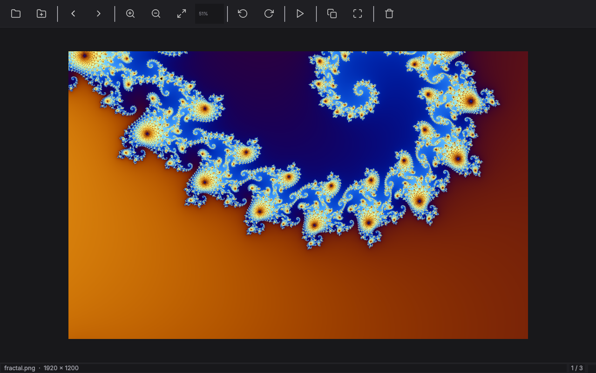

# LuminaView

A fast, lightweight image viewer for Linux built with Qt5. Single-file C++ source (~830 lines), no external dependencies beyond Qt.




## Features

- **Smooth zooming** — mouse wheel, toolbar buttons, or keyboard; animated zoom with cubic easing, debounced fast→smooth resampling for responsive rendering
- **Pan & fit** — drag to pan, double-click to toggle between 100% and fit-to-window
- **Animated rotation** — 90° rotations play as an on-canvas rotation animation while the source is transformed in memory
- **Async loading** — images decode off the main thread via `QtConcurrent`, with a bounded in-memory cache and automatic preloading of adjacent files for instant navigation
- **GIF & SVG support** — animated GIFs via `QMovie`; SVGs rendered at high resolution
- **Slideshow** — timed auto-advance (3.5 s) with play/pause toolbar control
- **Clipboard & delete** — copy current frame to clipboard or delete the file from disk
- **Drag & drop** — drop an image or folder anywhere to open it
- **Dark theme** — custom stylesheet with inline SVG icons (no icon theme required)
- **Desktop integration** — `.desktop` entry, hicolor icons (SVG + generated PNGs), MIME registration; can set itself as the default viewer for common image types
- **HiDPI aware**, remembers window geometry between sessions

## Supported formats

Everything your Qt installation's image format plugins provide (JPEG, PNG, WebP, GIF, BMP, TIFF, and more), plus SVG.

## Building

Requires **Qt 5** (Core, GUI, Widgets, Svg, Concurrent, PrintSupport) and a C++17 compiler.

```bash
./build.sh
```

or manually:

```bash
qmake LuminaView.pro
make -j$(nproc)
```

## Installing

```bash
./install.sh          # system-wide (uses sudo, installs to /usr/local)
./install.sh --user   # user-only (installs to ~/.local, no sudo)
./install.sh --rebuild --user   # force rebuild first
```

The installer builds if needed, then installs the binary, desktop entry, icons (generating PNG sizes when `rsvg-convert` or ImageMagick is available), MIME definitions, and registers LuminaView as the default handler for common image types.

## Keyboard shortcuts

| Key | Action |
|---|---|
| `Right` / `Space` | Next image |
| `Left` / `Backspace` | Previous image |
| `Home` / `End` | First / last image |
| `+`, `=`, `-` / `0` | Zoom in / out · reset to 100% |
| `F` | Fit to window |
| `Ctrl+L` / `Ctrl+R` | Rotate left / right |
| `S` | Toggle slideshow |
| `Ctrl+C` | Copy to clipboard |
| `Ctrl+O` / `Ctrl+Shift+O` | Open file / folder |
| `F11` | Fullscreen |
| `Delete` | Delete file from disk |
| `Esc` | Leave fullscreen |

## Usage

```bash
LuminaView                 # start with the drop-image placeholder
LuminaView photo.png       # open an image (loads its containing folder)
LuminaView ~/Pictures      # open a folder of images
```

---

## More projects by vSake

- **[Fih](https://github.com/vSake-clean/Fih)** — programming language with a compiler written in pure x86-64 assembly, no libc
- **[Szept](https://github.com/vSake-clean/Szept)** — end-to-end encrypted Android messenger with no server of its own (runs over Nostr relays)
- **[LunarDraw](https://github.com/vSake-clean/LunarDraw)** — GTK3/Cairo drawing app with layers
- **[StatusCycler](https://github.com/vSake-clean/StatusCycler)** — Vencord plugin that cycles your Discord custom status
- **[vencord-AutoReply](https://github.com/vSake-clean/vencord-AutoReply)** — Vencord plugin for automatic replies with triggers and filters
- **[vencord-StickyNotes](https://github.com/vSake-clean/vencord-StickyNotes)** — Vencord plugin for sticky notes on Discord users
- **[vencord-friendgroups](https://github.com/vSake-clean/vencord-friendgroups)** — Vencord plugin to group friends in the DM sidebar

If you like this project, consider leaving a ⭐ — it really helps!
